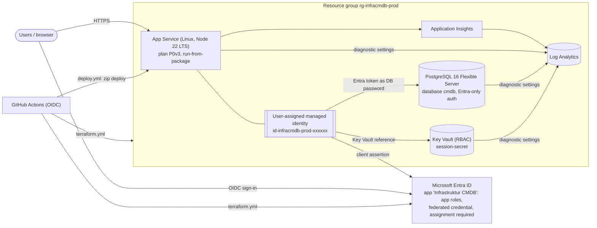

# Infrastruktur CMDB on Azure: deployment runbook

This runbook covers deploying Infrastruktur CMDB to Azure with **Terraform** (`infra/terraform`) and **GitHub Actions**. The environment has no passwords and no client secrets:

- The web app has one **user-assigned managed identity (UAMI)**. It uses that identity to read its session secret from Key Vault, to sign in to PostgreSQL with an Entra token, and as a **federated credential** of its own Entra app registration.
- PostgreSQL accepts **only Microsoft Entra authentication**.
- Terraform runs in GitHub Actions with **OIDC**, so no stored Azure credentials are needed.

Contents: [Architecture](#architecture) · [Prerequisites](#prerequisites) · [0. Bootstrap](#0-bootstrap-once) · [1. Terraform](#1-configure-and-apply-terraform) · [2. Database access](#2-grant-the-web-app-access-to-postgresql) · [3. GitHub](#3-github-setup) · [4. Deploy the app](#4-deploy-the-app) · [5. Users & roles](#5-assign-users-and-groups-to-app-roles) · [6. First login](#6-first-login-and-bootstrap_admins) · [7. Operations](#7-operations) · [8. Troubleshooting](#8-troubleshooting)

---

## Architecture



| Component | Details |
|---|---|
| App Service | Linux plan `P0v3` (variable). Runs `npm start` with Node 22 LTS, HTTPS only, TLS 1.2+, FTP and basic-auth publishing disabled, Always On, health check `/healthz`. The deployed zip is mounted read-only (`WEBSITE_RUN_FROM_PACKAGE=1`); there is no build on the server. |
| Sessions | Stored in PostgreSQL (`user_session`), so ARR affinity is off and scale-out is safe. |
| Migrations | Run at startup (`DB_MIGRATE_ON_START=true`). A Postgres advisory lock serialises them across instances. |
| PostgreSQL | Flexible Server 16 with Burstable `B_Standard_B1ms`, 32 GB storage (auto-grow) and 14-day PITR. Password authentication is off. Entra admin is a configurable group. Firewall: *Allow Azure services*; private networking is optional. |
| Key Vault | RBAC mode with purge protection. Holds `session-secret`, a 64-char random value generated by Terraform. The UAMI has *Key Vault Secrets User*. |
| Entra ID | Terraform manages the app registration `Infrastruktur CMDB`. Its redirect URIs are `https://<app>/auth/callback` and `https://<app>/` (post-logout). It defines 4 app roles, has an enterprise application with *assignment required*, and has a federated credential for the UAMI. |
| Monitoring | Log Analytics and workspace-based Application Insights. Web app console, HTTP and platform logs, PostgreSQL logs and Key Vault audit logs are sent to Log Analytics. |

**Repository layout**

| Path | Purpose |
|---|---|
| `infra/terraform/` | Terraform configuration (`versions.tf`, `providers.tf`, `variables.tf`, `main.tf`, `identity.tf`, `monitoring.tf`, `keyvault.tf`, `appservice.tf`, `postgres.tf`, `entra.tf`, `outputs.tf`). Also contains `terraform.tfvars.example`, `backend.tf.example` and `.terraform.lock.hcl`. |
| `scripts/grant-db-access.sh` | One-time step. It creates the UAMI's PostgreSQL role and grants it rights. This must run inside PostgreSQL as the Entra admin. |
| `.github/workflows/ci.yml` | Typecheck, tests (PostgreSQL 16 service container) and build on every push and PR. |
| `.github/workflows/terraform.yml` | fmt/validate and plan on PRs (plan shown in the job summary). On `main`: plan, then apply after approval in environment `production`. |
| `.github/workflows/deploy.yml` | On `main`: CI, then build the zip, deploy to App Service, smoke test `/healthz` + `/readyz`, and check Key Vault references. |

---

## Prerequisites

**Tools:** Azure CLI ≥ 2.60, Terraform ≥ 1.6 (CI uses 1.17.1), `psql` ≥ 14, `curl`, `jq`, and optionally the GitHub CLI `gh`. Azure Cloud Shell includes all of them (any Terraform ≥ 1.6 works).

**Permissions of the person doing the bootstrap:**

| Where | Role | Needed for |
|---|---|---|
| Subscription | *Owner*, or *Contributor* + *Role Based Access Control Administrator* | State storage, role assignments for the CI identities |
| Entra ID | *Application Administrator* (or *Cloud Application Administrator*) | App registrations, admin consent for delegated permissions |
| Entra ID | *Privileged Role Administrator* (one-time) | Granting Microsoft Graph **application** permissions to the Terraform identity |

**Entra groups.** Create these first (recommended):
- `SG-CMDB-PostgreSQL-Admins`: DBAs. This group becomes the PostgreSQL Entra administrator.
- `SG-CMDB-Admins`, `SG-CMDB-Editors`, `SG-CMDB-Operators`, `SG-CMDB-Viewers`: for the app roles. Group assignment requires Entra ID P1/P2.

The shell snippets below use these variables:

```bash
SUBSCRIPTION_ID=00000000-0000-0000-0000-000000000000
LOCATION=germanywestcentral
GH_REPO=<org>/<repo>                  # e.g. my-org/infrastruktur-cmdb
az login && az account set --subscription "$SUBSCRIPTION_ID"
TENANT_ID=$(az account show --query tenantId -o tsv)
ME=$(az ad signed-in-user show --query id -o tsv)
```

---

## 0. Bootstrap (once)

### 0.1 Terraform state storage

The state contains secrets, including the session secret. Keep it in a dedicated storage account that allows **Entra ID access only** (no shared keys), with versioning and soft delete turned on.

```bash
TFSTATE_RG=rg-infracmdb-tfstate
TFSTATE_SA=stinfracmdbtfstate001          # globally unique, 3-24 lowercase letters/digits

az group create -n $TFSTATE_RG -l $LOCATION
az storage account create -n $TFSTATE_SA -g $TFSTATE_RG -l $LOCATION \
  --sku Standard_ZRS --kind StorageV2 --https-only true --min-tls-version TLS1_2 \
  --allow-blob-public-access false --allow-shared-key-access false
az storage account blob-service-properties update -g $TFSTATE_RG --account-name $TFSTATE_SA \
  --enable-versioning true \
  --enable-delete-retention true --delete-retention-days 30 \
  --enable-container-delete-retention true --container-delete-retention-days 30
SA_ID=$(az storage account show -n $TFSTATE_SA -g $TFSTATE_RG --query id -o tsv)
az role assignment create --assignee-object-id "$ME" --assignee-principal-type User \
  --role "Storage Blob Data Contributor" --scope "$SA_ID"
# RBAC can take a minute to propagate. If the next command returns 403, retry it.
az storage container create --name tfstate --account-name $TFSTATE_SA --auth-mode login
az lock create --name do-not-delete --lock-type CanNotDelete --resource-group $TFSTATE_RG
```

### 0.2 Terraform identity for GitHub Actions

```bash
TF_APP_ID=$(az ad app create --display-name "GitHub infrastruktur-cmdb Terraform" --query appId -o tsv)
TF_SP_OID=$(az ad sp create --id "$TF_APP_ID" --query id -o tsv)

# OIDC trust: plan on main, apply in environment "production", plan on PRs
# (skip pull_request if you use the separate plan identity from 0.3)
for subject in "ref:refs/heads/main" "environment:production" "pull_request"; do
  az ad app federated-credential create --id "$TF_APP_ID" --parameters "{
    \"name\": \"github-$(echo "$subject" | tr ':/' '--')\",
    \"issuer\": \"https://token.actions.githubusercontent.com\",
    \"subject\": \"repo:$GH_REPO:$subject\",
    \"audiences\": [\"api://AzureADTokenExchange\"]}"
done

# Azure RBAC: create resources + assign only the three roles the configuration needs
# (Key Vault Secrets User / Secrets Officer, Website Contributor)
az role assignment create --assignee-object-id "$TF_SP_OID" --assignee-principal-type ServicePrincipal \
  --role Contributor --scope "/subscriptions/$SUBSCRIPTION_ID"
ROLES="4633458b-17de-408a-b874-0445c86b69e6, b86a8fe4-44ce-4948-aee5-eccb2c155cd7, de139f84-1756-47ae-9be6-808fbbe84772"
az role assignment create --assignee-object-id "$TF_SP_OID" --assignee-principal-type ServicePrincipal \
  --role "Role Based Access Control Administrator" --scope "/subscriptions/$SUBSCRIPTION_ID" \
  --condition-version "2.0" --condition "((!(ActionMatches{'Microsoft.Authorization/roleAssignments/write'})) OR (@Request[Microsoft.Authorization/roleAssignments:RoleDefinitionId] ForAnyOfAnyValues:GuidEquals {$ROLES})) AND ((!(ActionMatches{'Microsoft.Authorization/roleAssignments/delete'})) OR (@Resource[Microsoft.Authorization/roleAssignments:RoleDefinitionId] ForAnyOfAnyValues:GuidEquals {$ROLES}))"
az role assignment create --assignee-object-id "$TF_SP_OID" --assignee-principal-type ServicePrincipal \
  --role "Storage Blob Data Contributor" --scope "$SA_ID"
```

**Microsoft Graph application permissions.** These are required because Terraform manages the app registration. A *Privileged Role Administrator* or *Global Administrator* must run this:

```bash
GRAPH_SP=$(az ad sp show --id 00000003-0000-0000-c000-000000000000 --query id -o tsv)
grant_graph() { # <permission> [principal object id, default: $TF_SP_OID]
  local principal="${2:-$TF_SP_OID}" role_id
  role_id=$(az ad sp show --id 00000003-0000-0000-c000-000000000000 --query "appRoles[?value=='$1'].id | [0]" -o tsv)
  az rest --method POST --url "https://graph.microsoft.com/v1.0/servicePrincipals/$principal/appRoleAssignments" \
    --body "{\"principalId\":\"$principal\",\"resourceId\":\"$GRAPH_SP\",\"appRoleId\":\"$role_id\"}"
}
grant_graph Application.ReadWrite.OwnedBy        # always: create/manage its own app registration
# Only if entra_grant_admin_consent = true:
#   grant_graph Application.Read.All
#   grant_graph DelegatedPermissionGrant.ReadWrite.All
# Only if entra_app_role_assignments is used:
#   grant_graph AppRoleAssignment.ReadWrite.All
```

> The optional permissions (`DelegatedPermissionGrant.ReadWrite.All`, `AppRoleAssignment.ReadWrite.All`) are **tenant-critical**: an identity that holds them can grant itself further rights. If you add them, protect the pipeline accordingly: environment approvals, branch protection and a separate PR plan identity. The least-privilege default is different. Leave `entra_grant_admin_consent = false` and `entra_app_role_assignments = {}`, then grant consent and assign groups in the portal (steps 1 and 5).

### 0.3 Optional: read-only identity for pull-request plans

A PR workflow runs code that nobody has reviewed yet. Give PR plans a separate, read-only identity:

```bash
PLAN_APP_ID=$(az ad app create --display-name "GitHub infrastruktur-cmdb Terraform plan" --query appId -o tsv)
PLAN_SP_OID=$(az ad sp create --id "$PLAN_APP_ID" --query id -o tsv)
az ad app federated-credential create --id "$PLAN_APP_ID" --parameters "{\"name\":\"github-pull-request\",
  \"issuer\":\"https://token.actions.githubusercontent.com\",\"subject\":\"repo:$GH_REPO:pull_request\",
  \"audiences\":[\"api://AzureADTokenExchange\"]}"
# Reader cannot list web app settings or workspace keys -> small custom role
# (if a plan fails with 403 on another */list or */action call, add that action here)
az role definition create --role-definition "{\"Name\":\"Infrastruktur CMDB Terraform Plan Reader\",
  \"Description\":\"Read-only access for terraform plan, including web app settings\",
  \"Actions\":[\"*/read\",\"Microsoft.Web/sites/config/list/action\",
    \"Microsoft.OperationalInsights/workspaces/sharedKeys/action\"],
  \"AssignableScopes\":[\"/subscriptions/$SUBSCRIPTION_ID\"]}"
az role assignment create --assignee-object-id "$PLAN_SP_OID" --assignee-principal-type ServicePrincipal \
  --role "Infrastruktur CMDB Terraform Plan Reader" --scope "/subscriptions/$SUBSCRIPTION_ID"
az role assignment create --assignee-object-id "$PLAN_SP_OID" --assignee-principal-type ServicePrincipal \
  --role "Storage Blob Data Reader" --scope "$SA_ID"           # PR plans run with -lock=false
grant_graph Directory.Read.All "$PLAN_SP_OID"                 # read app registration, grants, assignments
```

Add `PLAN_SP_OID` to `terraform_plan_principal_object_ids`. Terraform then gives this identity *Key Vault Secrets User*, which it needs to refresh the secret.

### 0.4 Identity for the app deployment (deploy.yml)

```bash
DEPLOY_APP_ID=$(az ad app create --display-name "GitHub infrastruktur-cmdb Deploy" --query appId -o tsv)
DEPLOY_SP_OID=$(az ad sp create --id "$DEPLOY_APP_ID" --query id -o tsv)
az ad app federated-credential create --id "$DEPLOY_APP_ID" --parameters "{\"name\":\"github-production\",
  \"issuer\":\"https://token.actions.githubusercontent.com\",\"subject\":\"repo:$GH_REPO:environment:production\",
  \"audiences\":[\"api://AzureADTokenExchange\"]}"
```

Put `DEPLOY_SP_OID` into `deployment_principal_object_id`. Terraform then assigns it **Website Contributor** on the web app only. If your organisation customised the GitHub OIDC subject claim template, adapt the `subject` values.

---

## 1. Configure and apply Terraform

```bash
cd infra/terraform
cp backend.tf.example backend.tf                 # set storage account / container / key from 0.1
cp terraform.tfvars.example terraform.tfvars     # see below
```

Important values in `terraform.tfvars`:

| Variable | Value |
|---|---|
| `subscription_id`, `location` | Target subscription and region (default `germanywestcentral`). |
| `terraform_principal_object_ids` | `[$ME, $TF_SP_OID]`. List **every** principal that runs `apply`. Each one becomes an owner of the app registration and *Key Vault Secrets Officer*. If you leave one out, the plan flips depending on who runs it. |
| `deployment_principal_object_id` | `$DEPLOY_SP_OID` |
| `postgres_entra_admin` | `object_id` / `name` / `type` of `SG-CMDB-PostgreSQL-Admins` (`az ad group show -g SG-CMDB-PostgreSQL-Admins --query id -o tsv`). |
| `bootstrap_admins` | Your UPN(s), see step 6. |
| `app_base_url` | Only for a custom domain (otherwise `https://<web app>.azurewebsites.net`). |
| `entra_grant_admin_consent`, `entra_app_role_assignments` | See 0.2 and step 5. |

Apply locally, as yourself, for the first time:

```bash
terraform init                       # remote state from backend.tf
terraform plan -out tfplan
terraform apply tfplan               # about 10-15 min (PostgreSQL); includes a 90 s wait for Key Vault RBAC
terraform output
```

Terraform creates the resource group, the UAMI, Log Analytics and Application Insights, Key Vault with `session-secret`, the App Service plan and web app with all app settings, PostgreSQL with its Entra admin, database `cmdb` and firewall rule, and the Entra app registration, enterprise application and federated credential. Every app setting below is derived from these resources, so there are no manual settings:

`NODE_ENV=production`, `APP_BASE_URL`, `SESSION_SECRET=@Microsoft.KeyVault(SecretUri=…/secrets/session-secret)`, `AUTH_MODE=entra`, `ENTRA_TENANT_ID`, `ENTRA_CLIENT_ID`, `ENTRA_USE_MANAGED_IDENTITY=true`, `ENTRA_REQUIRE_APP_ROLE`, `DEFAULT_ROLE`, `BOOTSTRAP_ADMINS`, `DB_AUTH=entra`, `PGHOST`, `PGPORT`, `PGDATABASE=cmdb`, `PGUSER=<UAMI name>`, `PGSSLMODE=require`, `AZURE_CLIENT_ID=<UAMI client id>`, `DB_MIGRATE_ON_START=true`, `MAP_TILE_URL`, `MAP_TILE_ATTRIBUTION`, `APPLICATIONINSIGHTS_CONNECTION_STRING`, `SCM_DO_BUILD_DURING_DEPLOYMENT=false`, `WEBSITE_RUN_FROM_PACKAGE=1`, `STORAGE_DRIVER=azure-blob`, `AZURE_STORAGE_ACCOUNT_URL`, `AZURE_STORAGE_CONTAINER=attachments`, `ATTACHMENT_MAX_MB`.

> Terraform owns all app settings, so it reverts portal changes on the next apply. Add extra settings through `extra_app_settings`, e.g. `{ BRAND_PRIMARY_COLOR = "#2563eb", LOG_LEVEL = "debug" }`.

**Admin consent.** Skip this if `entra_grant_admin_consent = true`. Otherwise, in the portal go to *Entra ID → App registrations → Infrastruktur CMDB → API permissions → Grant admin consent for \<tenant\>* (permissions: openid, profile, email, offline_access, User.Read). Without consent, users see a consent prompt, or *"Need admin approval"* if user consent is disabled.

---

## 2. Grant the web app access to PostgreSQL

Terraform cannot create database roles for Entra principals. This step has to run **inside PostgreSQL as the Entra admin**, and you need to do it once per server. Prerequisites: you are a member of `SG-CMDB-PostgreSQL-Admins` and have run `az login` in the same tenant.

```bash
cd <repo root>
terraform -chdir=infra/terraform output -raw grant_db_access_command; echo   # review
eval "$(terraform -chdir=infra/terraform output -raw grant_db_access_command)"
```

The script (`scripts/grant-db-access.sh`, idempotent):

1. Optionally (`--add-client-ip`) adds a temporary firewall rule for your public IP and removes it again on exit.
2. Gets a token with `az account get-access-token --resource-type oss-rdbms` and connects with `psql` as the admin. For a **group** admin, the user name is the **group name**.
3. In database `postgres`, runs `SELECT * FROM pgaadauth_create_principal('<uami-name>', false, false);`. Use `--identity-object-id <managed_identity_principal_id>` to map by object ID if principal names are ambiguous.
4. In database `cmdb`, runs `GRANT CONNECT, CREATE, TEMPORARY ON DATABASE cmdb` and `GRANT USAGE, CREATE ON SCHEMA public` to the identity.
5. Transfers **ownership** of database `cmdb` and schema `public` to the identity (`ALTER DATABASE … OWNER TO`, `ALTER SCHEMA public OWNER TO`). The admin first becomes a member of the app role, because PostgreSQL 16 only allows handing ownership to a role you can `SET ROLE` to. This also lets admins `SET ROLE` for maintenance.

Why ownership: the app runs its own migrations, and the identity already owns every table it creates. Owning the database and schema as well means future migrations never fail with *must be owner of …* (e.g. `ALTER SCHEMA`, `CREATE EXTENSION`). If Azure refuses the transfer, the script only warns. The grants from step 4 are enough for the current migrations; this was tested by running all migrations as a grants-only role.

If the server uses private access, run the script from a machine inside the VNet (jump host or Cloud Shell with VNet integration).

---

## 3. GitHub setup

1. Commit `infra/terraform/backend.tf`, `infra/terraform/terraform.tfvars` and `infra/terraform/.terraform.lock.hcl`. They contain no secrets.
2. Create the environment **`production`** (*Settings → Environments*). Add **required reviewers** and restrict deployment branches to `main`. Both workflows use it: Terraform apply and the app deployment.
3. Add the secrets and variables:

| Name | Kind | Level | Value |
|---|---|---|---|
| `AZURE_TENANT_ID` | secret | repository | `$TENANT_ID` |
| `AZURE_SUBSCRIPTION_ID` | secret | repository | `$SUBSCRIPTION_ID` |
| `TF_AZURE_CLIENT_ID` | secret | repository | `$TF_APP_ID` |
| `TF_PLAN_AZURE_CLIENT_ID` | secret | repository | `$PLAN_APP_ID` (optional, 0.3) |
| `AZURE_CLIENT_ID` | secret | environment `production` | `$DEPLOY_APP_ID` |
| `AZURE_WEBAPP_NAME`, `AZURE_RESOURCE_GROUP`, `AZURE_WEBAPP_URL` | variable | repository | `terraform output github_variables` |

```bash
gh secret set AZURE_TENANT_ID --body "$TENANT_ID"
gh secret set AZURE_SUBSCRIPTION_ID --body "$SUBSCRIPTION_ID"
gh secret set TF_AZURE_CLIENT_ID --body "$TF_APP_ID"
gh secret set AZURE_CLIENT_ID --env production --body "$DEPLOY_APP_ID"
terraform -chdir=infra/terraform output -json github_variables |
  jq -r 'to_entries[] | "\(.key)\t\(.value)"' |
  while IFS=$'\t' read -r k v; do gh variable set "$k" --body "$v"; done
```

How the workflows behave:

- **`terraform.yml`** runs on changes under `infra/terraform/`. On a PR it runs `fmt -check`, `validate`, then `plan` and writes the plan to the job summary. On `main` the plan job shows the plan. If there are changes, the `apply` job waits for approval in `production`, plans the approved commit again and applies exactly that plan. Plan files are never uploaded as artifacts because they contain secrets.
- **`deploy.yml`** runs on pushes to `main` (except infra/docs-only changes) and on manual dispatch. It runs CI, then builds `deploy.zip` (`dist/` plus production `node_modules`), deploys it with `azure/webapps-deploy@v3` (OIDC), smoke-tests `/healthz` and `/readyz`, and **fails if a Key Vault reference is not resolved**. An unresolved reference would reach the app as the literal `@Microsoft.KeyVault(...)` string and silently become the session secret.

---

## 4. Deploy the app

Push to `main`, or run **Actions → Deploy → Run workflow**. To do the first deployment manually from a workstation:

```bash
npm ci && npm run build
rm -rf staging && mkdir staging && cp -r dist package.json package-lock.json staging/
(cd staging && npm ci --omit=dev --ignore-scripts && zip -qr ../deploy.zip dist node_modules package.json package-lock.json)
az webapp deploy -g <rg> -n <web app> --src-path deploy.zip --type zip
curl -fsS https://<web app>.azurewebsites.net/readyz
```

---

## 5. Assign users and groups to app roles

The enterprise application requires assignment. Users who are **not assigned** are rejected by Entra ID (`AADSTS50105`) before they reach the app. The ID token's `roles` claim carries the role. If a user has several roles, the highest one wins.

You can assign roles in three ways:

- **Portal:** *Entra ID → Enterprise applications → Infrastruktur CMDB → Users and groups → Add user/group → select role*.
- **Terraform:** list the group object IDs per role in `entra_app_role_assignments` (needs `AppRoleAssignment.ReadWrite.All`, see 0.2):
  ```hcl
  entra_app_role_assignments = {
    "CMDB.Admin"  = ["<object id of SG-CMDB-Admins>"]
    "CMDB.Viewer" = ["<object id of SG-CMDB-Viewers>"]
  }
  ```
- **CLI:**
  ```bash
  SP=$(terraform -chdir=infra/terraform output -raw entra_enterprise_app_object_id)
  ROLE=$(terraform -chdir=infra/terraform output -json entra_app_role_ids | jq -r '."CMDB.Editor"')
  GROUP=$(az ad group show -g SG-CMDB-Editors --query id -o tsv)
  az rest --method POST --url "https://graph.microsoft.com/v1.0/servicePrincipals/$SP/appRoleAssignedTo" \
    --body "{\"principalId\":\"$GROUP\",\"resourceId\":\"$SP\",\"appRoleId\":\"$ROLE\"}"
  ```

| App role | CMDB role | Permissions |
|---|---|---|
| `CMDB.Admin` | Administrator | Everything, including **user management** (roles, activation, plant scoping), deleting plants, and the global **audit log** and its export |
| `CMDB.Editor` | Editor | Create, change and delete infrastructure assets, buildings, floors and floor plans; create and change plants; **import** data; plus all Operator rights |
| `CMDB.Operator` | Operator | Read access plus **notes, activities and asset status** changes (e.g. on-site technicians) |
| `CMDB.Viewer` | Viewer | Read-only access and **exports** |

Notes:

- **Plant scoping** is not an Entra concept. Administrators manage it in the app under **Administration → Users**, where they restrict a user to one or more plants.
- Role changes take effect at the user's **next sign-in**. Sessions slide for up to 10 hours. To lock a user out immediately, deactivate them in Administration → Users, which also deletes their sessions.
- Group assignment needs Entra ID P1/P2, and nested groups are not resolved. Assign the groups whose members should get access directly.

---

## 6. First login and BOOTSTRAP_ADMINS

1. Put your UPN into `bootstrap_admins` (this becomes app setting `BOOTSTRAP_ADMINS`) and apply. These users always get the admin role, even without the `CMDB.Admin` role.
2. Bootstrap admins **still need an assignment** in the enterprise application, because assignment is required. Assign yourself `CMDB.Admin` (or any role) as in step 5.
3. Open `terraform output -raw app_base_url`. You are redirected to Entra ID, sign in, and land on the dashboard. Your user record is created on the first sign-in.
4. Under **Administration → Users**, pre-provision colleagues by e-mail if needed (they are matched on first sign-in) and set **plant scopes**.
5. Once a `CMDB.Admin` group assignment exists, keep `bootstrap_admins` as a small break-glass list, or empty it.

---

## 7. Operations

- **Logs.** Use the portal **Log stream** (web app → *Log stream*). `az webapp log tail` may need basic-auth publishing credentials, which are disabled, so use the portal or Log Analytics. The app writes JSON lines in production. Example query: `AppServiceConsoleLogs | where TimeGenerated > ago(1h) | project TimeGenerated, ResultDescription | order by TimeGenerated desc`. PostgreSQL logs are in `AzureDiagnostics | where ResourceProvider == "MICROSOFT.DBFORPOSTGRESQL"`.
- **Scaling.** Change `app_service_plan_worker_count` or `app_service_plan_sku`. Sessions and migrations are safe with multiple instances.
- **Rotate the session secret.** Run `terraform apply -replace=random_password.session_secret`. This signs out all users. The app picks up the new version within 24 h, or immediately after `az webapp restart`.
- **Backups.** PITR is 14 days (`postgres_backup_retention_days`). To restore, run `az postgres flexible-server restore -g <rg> -n <new> --source-server <name> --restore-time <UTC>`, re-run `grant-db-access.sh` against the new server if needed, and then point Terraform at it.
- **Protected database.** `azurerm_postgresql_flexible_server_database.cmdb` has `prevent_destroy`. Plans that would replace the server or database fail on purpose.
- **Private networking (production hardening).** Set `app_service_subnet_id` (subnet delegated to `Microsoft.Web/serverFarms`), `postgres_delegated_subnet_id` (subnet delegated to `Microsoft.DBforPostgreSQL/flexibleServers`) and `postgres_private_dns_zone_id` (zone `*.postgres.database.azure.com` linked to the VNet). The firewall rules are then dropped and the server has no public endpoint. **Changing the network mode replaces the server**, so plan a dump/restore. Consider a private endpoint for Key Vault as well.
- **E-mail notifications (SMTP).** The SMTP server and the warranty reminder rules are configured in the app under **Administration → Settings & notifications** (stored in the database table `app_setting`, the SMTP password AES-256-GCM encrypted with `SETTINGS_ENCRYPTION_KEY` from Key Vault). Terraform creates that key (`random_password.settings_encryption_key`); **do not rotate it casually**, stored secrets become unreadable and must be re-entered. The daily digest is sent by an in-process scheduler, which needs **Always On** (enabled by Terraform, `always_on = true`) so the app is not unloaded overnight. With several instances only one sends (PostgreSQL advisory lock + dedupe log). Allow outbound SMTP from the App Service outbound IPs to your relay (`az webapp show -g <rg> -n <app> --query outboundIpAddresses`); Azure blocks outbound port 25 to the internet, so use an internal relay (via VNet integration) or a submission port (587/465). Details: [NOTIFICATIONS.md](NOTIFICATIONS.md).
- **Attachments (Blob Storage).** Photos, plans and documents are stored in the storage account from `storage.tf` (container `attachments`); metadata stays in PostgreSQL (table `attachment`). The account has **shared keys and anonymous access disabled**: the app uses its UAMI with *Storage Blob Data Contributor*, and the azurerm provider runs with `storage_use_azuread = true`. With azurerm 4.x the container is created through Azure Resource Manager, so the Terraform identity needs no data-plane role; if a plan ever fails with `403 AuthorizationPermissionMismatch` on blob properties, give the Terraform identity *Storage Blob Data Contributor* on the account. Files are always served through the app (permission and plant-scope checks), never directly from the account. **Versioning and soft delete** (`storage_soft_delete_days`, default 30) let you restore a deleted or overwritten file in the portal (*Storage account → Containers → attachments → Show deleted blobs*). Replication defaults to ZRS (`storage_replication_type`). For private networking set `storage_public_network_access_enabled = false` and add a private endpoint for the blob service in the VNet used by the App Service. The upload limit is `attachment_max_mb` (default 50 MB).
- **Application Insights.** The connection string is already set. Request telemetry needs the Application Insights / OpenTelemetry SDK in the app (not yet included).
- **Maps.** By default the plant map uses a **built-in world map** (country borders from Natural Earth, bundled with the app): browsers contact no external map service. For a detailed street map, point `map_tile_url` to your own tile server, for example **Azure Maps** (e.g. `https://atlas.microsoft.com/map/tile?api-version=2024-04-01&tilesetId=microsoft.base.road&zoom={z}&x={x}&y={y}&tileSize=256&subscription-key=<key>`). That key is visible to browsers, so restrict it with the Azure Maps account's CORS/allowed origins and set the Azure Maps attribution. Alternatively, use an **internal tile server or caching proxy**. The app adds the tile host to its Content-Security-Policy automatically.

---

## 8. Troubleshooting

**App does not start / health check fails**

| Symptom | Cause / fix |
|---|---|
| Log stream: `Invalid configuration: …` | A required setting is missing or invalid, e.g. `ENTRA_CLIENT_ID` or `SESSION_SECRET` shorter than 32 characters. Check the Terraform outputs and app settings. |
| Log stream: `Migration … failed: permission denied for schema public` | Step 2 has not been run. Run `grant-db-access.sh`. |
| `Migration … failed: must be owner of table …` | Objects in `public` were created by another role, e.g. migrations run manually as the admin. Run `ALTER TABLE … OWNER TO "<uami-name>"`; the script warns about such objects. |
| *Container didn't respond to HTTP pings on port 8080* | The app crashed during startup (see the log), or startup took longer than 230 s. Do not override `PORT`; App Service sets it. |
| Health check marks the instance unhealthy | `/healthz` does not touch the database, so the process is down. With 2 or more instances, an unhealthy instance leaves the load balancer after 10 min (`health_check_eviction_time_in_min`) and is replaced if it stays unhealthy. |

**Key Vault references** (portal: web app → *Environment variables*, *Source: Key vault* shows the status)

- *AccessToKeyVaultDenied*: the UAMI's *Key Vault Secrets User* role is missing or still propagating. `key_vault_reference_identity_id` must be the UAMI. Fix it, then run `az webapp restart`.
- *SecretNotFound*: the secret name or vault is wrong. Check `terraform state show azurerm_key_vault_secret.session_secret`.
- To check from the CLI: `az rest --method get --url "/subscriptions/<sub>/resourceGroups/<rg>/providers/Microsoft.Web/sites/<app>/config/configreferences/appsettings?api-version=2024-04-01"`.

**Sign-in (Entra ID)**

| Error | Cause / fix |
|---|---|
| `AADSTS50011` redirect URI mismatch | The browser uses a different host than `APP_BASE_URL`, e.g. a custom domain. Set `app_base_url`, or add the host to `entra_additional_redirect_uris`, and apply. |
| `AADSTS50105` user not assigned | Assign the user or their group to an app role (step 5). |
| `AADSTS65001` / `AADSTS90094` consent required / admin approval | Grant admin consent (step 1). |
| `AADSTS70021` / `AADSTS700213` *No matching federated identity record* | The federated credential must have subject = UAMI **principal (object) ID**, issuer `https://login.microsoftonline.com/<tenant>/v2.0` and audience `api://AzureADTokenExchange`. `AZURE_CLIENT_ID` must be **that** UAMI's client ID. Check with `az ad app federated-credential list --id <ENTRA_CLIENT_ID>`. |
| `ManagedIdentityCredential authentication failed` | The UAMI is not assigned to the web app, or `AZURE_CLIENT_ID` is wrong. |
| `AADSTS7000215` / `AADSTS7000218` invalid or missing client credential | `ENTRA_USE_MANAGED_IDENTITY` must be `true` (secretless). Check that the federated credential exists. |
| App page *Access denied: not assigned a role* | `ENTRA_REQUIRE_APP_ROLE=true` and the token has no `CMDB.*` role. Assign a role, then sign out and back in. |
| *The sign-in request expired or is invalid* | The session cookie from `/auth/login` did not come back to `/auth/callback`. Usually the user started on a different host name than `APP_BASE_URL`. Always use the canonical URL. |

**Database (`DB_AUTH=entra`)**

| Error | Cause / fix |
|---|---|
| `password authentication failed for user "id-…"` | No PostgreSQL role for the identity (run step 2). Or `PGUSER` ≠ role name (case-sensitive). Or the role was mapped to a different principal with the same display name (re-create with `--identity-object-id`). Or the token was issued for another identity (`AZURE_CLIENT_ID`). Use `SELECT * FROM pgaadauth_list_principals(false);` as admin to see the mappings. |
| Timeout / `no pg_hba.conf entry` | Network path: *Allow Azure services* rule (`postgres_allow_azure_services`) or VNet. From a workstation, use `--add-client-ip` or `postgres_firewall_rules`. |
| `grant-db-access.sh`: *Cannot connect* | `--admin-user` must be the Entra admin. For a group admin, that is the group's display name, and you must be a member. `az login` must use the server's tenant. Check the firewall. |
| `pgaadauth_create_principal`: principal not found | The UAMI name is not unique or not in this tenant. Use `--identity-object-id $(terraform output -raw managed_identity_principal_id)`. |

**Terraform / GitHub Actions**

| Error | Cause / fix |
|---|---|
| First apply: 403 on `azurerm_key_vault_secret` | Key Vault RBAC was still propagating despite the 90 s wait. Run `apply` again. |
| `Insufficient privileges to complete the operation` (azuread) | Graph permissions are missing (0.2), or the Terraform identity is not an owner of the app registration. Add it to `terraform_principal_object_ids` and apply once as an admin. |
| Key Vault name already in use | A soft-deleted vault with this name exists. Recover it (`az keyvault recover`) or set a different `name_suffix`. |
| `Instance cannot be destroyed` (`prevent_destroy`) | The plan would replace the database/server, e.g. because the network mode changed. Review the plan and migrate the data deliberately. |
| Login: `AADSTS700213 … subject 'repo:…:pull_request'` | A federated credential for that subject is missing (0.2/0.3), or the org uses a custom OIDC subject template. |
| `Error acquiring the state lock` | Another run holds the lock. If it crashed, run `terraform force-unlock <id>`. |
| Check warning `web_app_default_hostname` | Azure assigned a different default host name. Set `app_base_url` to the shown URL and apply. |
| Plan always shows owner / Key Vault role changes | Not every principal that runs Terraform is listed in `terraform_principal_object_ids`. |
